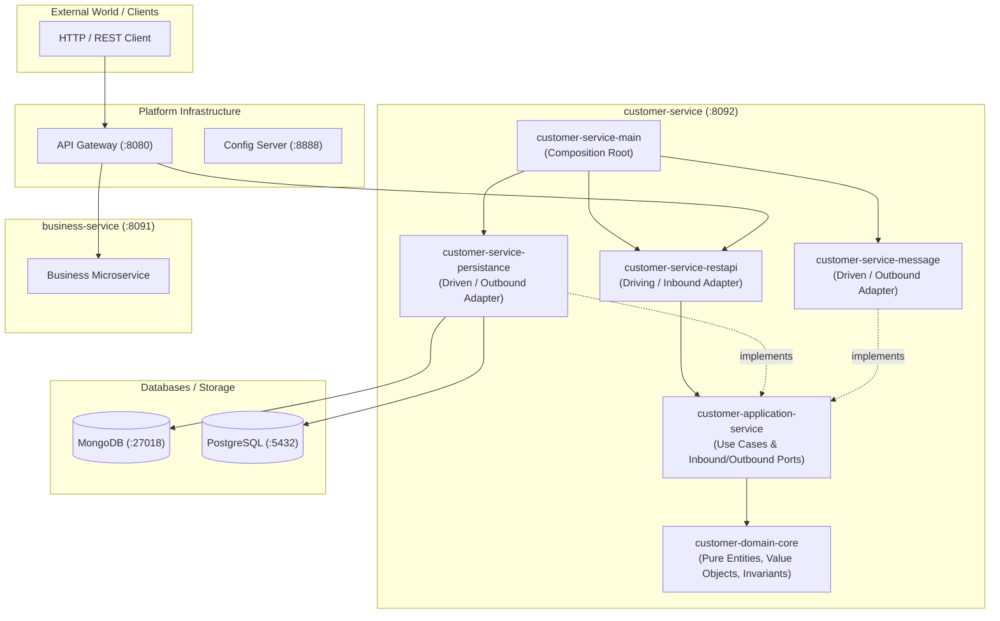
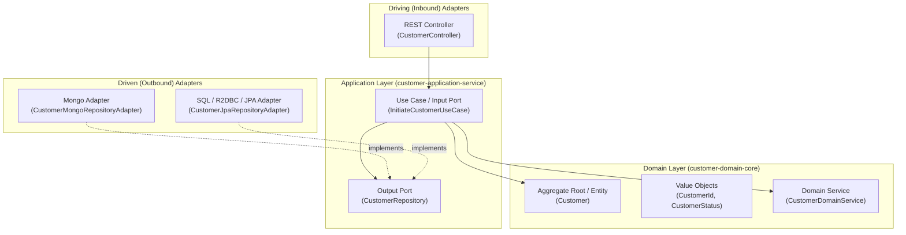
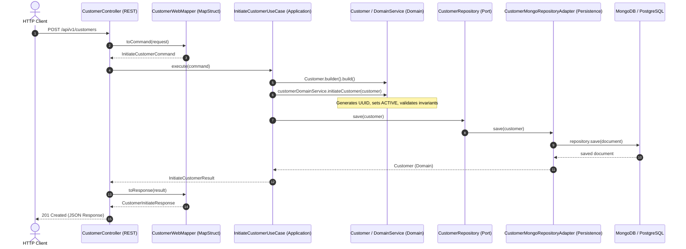

# Spring Microservices Platform

A modern, production-grade microservices architecture built with **Java 25**, **Spring Boot 4**, **Domain-Driven Design (DDD)**, and **Hexagonal Architecture (Ports & Adapters / Clean Architecture)**.

---

## 📑 Table of Contents
1. [Architecture Overview](#-architecture-overview)
2. [Clean Architecture & Hexagonal Structure](#-clean-architecture--hexagonal-structure)
3. [Domain-Driven Design (DDD) Tactical Patterns](#-domain-driven-design-ddd-tactical-patterns)
4. [Pluggable Polyglot Persistence](#-pluggable-polyglot-persistence)
5. [Gradle Multi-Project & Composite Build Structure](#-gradle-multi-project--composite-build-structure)
6. [Module Directory Reference](#-module-directory-reference)
7. [Request Flow & Lifecycle](#-request-flow--lifecycle)
8. [Getting Started & Running the Services](#-getting-started--running-the-services)

---

## 🏛️ Architecture Overview

The system is designed around the **Dependency Inversion Principle (DIP)**: the core domain contains purely enterprise business rules and has **zero dependencies** on external frameworks, UI, or databases. Infrastructure, persistence, and external APIs are decoupled adapters that plug into domain ports.



---

## 🔄 Clean Architecture & Hexagonal Structure

Each microservice (e.g., `customer-service`) strictly follows the **Hexagonal Architecture (Ports and Adapters)** paradigm.



### Module Responsibilities:

| Module | Architectural Role | Responsibilities | Dependencies |
| :--- | :--- | :--- | :--- |
| **`customer-domain-core`** | **Enterprise Business Rules** | Domain Entities, Value Objects, Domain Events, Domain Exceptions. Encapsulates business invariants. | **None** (Pure Java, no Spring, no JPA) |
| **`customer-application-service`** | **Application Business Rules** | Use cases, input/output DTOs (Commands/Results), outbound ports (Repository interfaces). | `customer-domain-core`, `istad-common-domain` |
| **`customer-service-restapi`** | **Primary (Driving) Adapter** | REST Controllers, Request/Response DTOs, Web Mappers (MapStruct). Translates HTTP to Use Case Commands. | `customer-application-service`, Spring Web |
| **`customer-service-persistance`** | **Secondary (Driven) Adapter** | Implements repository ports. Contains database entities/documents (JPA/R2DBC, MongoDB), Spring Data Repositories, and Mappers. | `customer-application-service`, Spring Data |
| **`customer-service-message`** | **Secondary (Driven) Adapter** | Message publishers and event consumers (e.g., Kafka / RabbitMQ). | `customer-application-service` |
| **`customer-service-main`** | **Composition Root** | Bootstrapping (`@SpringBootApplication`), configuration files (`application.yaml`), and bean assembly. | Assembles all adapters and modules |

---

## 💎 Domain-Driven Design (DDD) Tactical Patterns

The codebase applies key DDD tactical patterns:

1. **Aggregate Root & Base Entity (`AggreateRoot<ID>`, `BaseEntity<ID>`)**:
   - Entities have identity (`CustomerId`) that remains consistent through state changes.
   - State modifications are protected by business invariants inside the Aggregate Root (e.g., `initiateCustomer()`, `deactivateCustomer()`).
2. **Value Objects (`CustomerId`, `Money`, `CustomerStatus`)**:
   - Immutable records wrapping domain values with validation and type safety.
3. **Domain Services (`CustomerDomainService`)**:
   - Coordinates business logic that does not naturally belong to a single entity.
4. **Domain Events (`DomainEvent`)**:
   - Represents state changes or significant occurrences within the domain lifecycle.

---

## 🔌 Pluggable Polyglot Persistence

The persistence module ([`customer-service-persistance`](file:///Users/thornie/Documents/ITE-Gen3/spring-microservices/microservices/customer-service/customer-service-persistance)) supports **pluggable database implementations** without changing a single line of domain code:

```mermaid
flowchart LR
    Port["CustomerRepository (Port)"]
    
    subgraph PersistenceAdapters ["Pluggable Adapters"]
        Mongo["CustomerMongoRepositoryAdapter<br/>@ConditionalOnProperty(db-type=mongo)"]
        Sql["CustomerJpaRepositoryAdapter<br/>@ConditionalOnProperty(db-type=postgres)"]
    end

    Port <|.. Mongo
    Port <|.. Sql

    Mongo --> MongoDB[("MongoDB")]
    Sql --> PostgreSQL[("PostgreSQL")]
```

### Switching Databases via Configuration:
You can toggle between MongoDB and PostgreSQL at runtime in [`application.yaml`](file:///Users/thornie/Documents/ITE-Gen3/spring-microservices/microservices/customer-service/customer-service-main/src/main/resources/application.yaml):

```yaml
# Toggle database: 'mongo' or 'postgres'
persistence:
  db-type: mongo

spring:
  # MongoDB configuration (Reactive)
  mongodb:
    host: localhost
    port: 27018
    username: mongo
    password: admin
    database: db_customer
    authentication-database: admin
    representation:
      uuid: standard

  # PostgreSQL / R2DBC configuration (Reactive)
  r2dbc:
    url: r2dbc:postgresql://localhost:5432/app_db
    username: admin
    password: postgres@123456789
```

---

## 🛠️ Gradle Multi-Project & Composite Build Structure

The project utilizes **Gradle Composite Builds (`includeBuild`)** and **Convention Plugins (`build-logic`)** for clean modularization, build caching, and isolated compilation.

```
spring-microservices (Root Composite Build)
├── build-logic/                      <-- Shared Gradle Convention Plugins
│   ├── java-common-conventions
│   ├── spring-common-conventions
│   ├── spring-boot-common-conventions
│   └── spring-webflux-common-conventions
├── istad-common/                     <-- Reusable Platform Core Libraries
│   ├── istad-common-domain           <-- BaseEntity, AggregateRoot, ValueObjects
│   └── istad-common-restapi          <-- Common REST response envelopes & advice
├── infrastructure/                   <-- Platform Infrastructure Services
│   ├── api-gateway                   <-- Spring Cloud Gateway
│   └── config-server                 <-- Spring Cloud Config Server
└── microservices/                    <-- Domain Microservices
    ├── customer-service              <-- Customer Management Service
    └── business-service              <-- Business Operations Service
```

---

## 📂 Module Directory Reference

```
customer-service/
├── customer-service-main/                  # Bootstrapping & application.yaml
├── customer-service-domain/
│   ├── customer-domain-core/               # Pure Domain: Customer, Status, Invariants
│   └── customer-application-service/       # Use Cases, Ports, DTOs (Commands/Results)
├── customer-service-restapi/               # Controllers, Web DTOs, Web Mappers
├── customer-service-persistance/           # Database Adapters, Entities/Docs, DB Mappers
└── customer-service-message/               # Messaging / Event Publisher Adapters
```

---

## 🚀 Request Flow & Lifecycle

When a client initiates a new customer (`POST /api/v1/customers`):



---

## ⚡ Getting Started & Running the Services

### Prerequisites
- **Java 21 / 25**
- **Docker & Docker Compose**

### 1. Start Database Services via Docker
Start MongoDB using the root [`docker-compose.yml`](file:///Users/thornie/Documents/ITE-Gen3/spring-microservices/docker-compose.yml):

```bash
docker compose up -d
```

### 2. Build the Entire Project
Build all composite builds using the Gradle Wrapper:

```bash
./gradlew build
```

### 3. Run Customer Service
Run the main customer microservice:

```bash
./gradlew :microservices:customer-service:customer-service-main:bootRun
```

### 4. Test the API
Create a new customer via `cURL`:

```bash
curl -X POST http://localhost:8092/api/v1/customers \
  -H "Content-Type: application/json" \
  -d '{
    "username": "chanthorn",
    "familyName": "Kim",
    "givenName": "Chanthorn",
    "email": "chanthorn@example.com",
    "phoneNumber": "099877654"
  }'
```

Expected Response:
```json
{
  "customerId": "1ac89ea5-9020-4165-8f22-e3c2cf7926b5",
  "username": "chanthorn",
  "familyName": "Kim",
  "givenName": "Chanthorn",
  "email": "chanthorn@example.com",
  "phoneNumber": "099877654"
}
```
